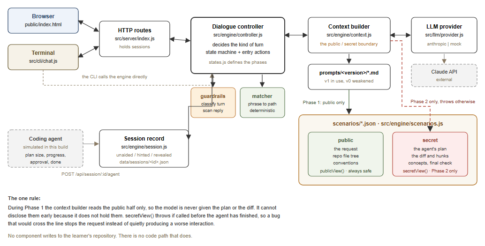

# Architecture



Source: [`architecture.svg`](architecture.svg).

---

## The rule the diagram is drawn around

During Phase 1 the context builder reads the **public** half of a scenario only.
The model is never given the agent's plan or the diff, so it cannot disclose
them early: it does not hold them. `secretView()` throws if it is called before
the agent has finished, so a bug that would cross the line stops the request
rather than quietly producing a worse interaction.

Nothing in the system writes to a learner's repository. There is no code path
that does.

## The state machine

```
                      ┌──────────────── PHASE 1 ────────────────┐
                      │   no verdicts, secret not in context    │
                      │                                          │
   IDLE ──plan≥thr──▶ ACTIVATE ──accepts──▶ PREDICT_FILES ──▶ PREDICT_MECHANISM
     │                    │                      │                    │
     │                    │                      └──── PAUSED ◀───────┘
     │                    │                     (coding agent needs the learner,
     │                    │                      from any Phase 1 state)
     │                    │                               │
     └─ below threshold ──┴──────────────────────────────┐│
        (stays silent)                                   ││
                                                 WAIT_FOR_AGENT
                                                         │
                                   agent done, diff extracted
                                                         ▼
                      ┌──────────────── PHASE 2 ────────────────┐
                      │  secret available, one gap per turn      │
                      │                                          │
   RECONCILE_FILES ──▶ RECONCILE_MECHANISM ──▶ GROUND ──▶ FINAL_CHECK ──▶ CARD ──▶ END

   "skip"  ends the run from any Phase 1 state
   "stop"  ends the session from anywhere
```

Defined as data in [`src/engine/states.js`](../src/engine/states.js): `PHASE`,
`ELICIT_ONLY`, `NEXT`, `canPause()`, `canExit()`.

**Entry actions.** `GROUND`, `FINAL_CHECK` and `CARD` say something the moment
they are entered, and that text is appended to the reply that caused the
transition. Without this, a state whose first job is to ask a question would
wait for a learner message to ask it, and the learner would be answering a
question they had not been shown. See `runEntryActions()` in `controller.js`.

## What each state does

| State | Phase | What happens | Secret available |
|---|---|---|---|
| `IDLE` | 1 | compare plan size with the learner's threshold | no |
| `ACTIVATE` | 1 | offer the check; `skip` ends it in one word | no |
| `PREDICT_FILES` | 1 | record the prediction, resolve phrases against the repo map, ask about ambiguity | no |
| `PREDICT_MECHANISM` | 1 | record how they think it should work, leave a question to mull | no |
| `PAUSED` | 1 | the coding agent needs the learner; remember where we were | no |
| `WAIT_FOR_AGENT` | 1 | nothing, until the agent finishes | no |
| `RECONCILE_FILES` | 2 | score the prediction deterministically, reveal only the gap | yes |
| `RECONCILE_MECHANISM` | 2 | grade the explanation against key points, reveal only what is missing | yes |
| `GROUND` | 2 | ask the prerequisite, then pitch the explanation to the answer | yes |
| `FINAL_CHECK` | 2 | one change not yet discussed; graded deterministically | yes |
| `CARD` | 2 | assemble the handover card from recorded facts | yes |

## Module map

| Module | Responsibility | Never does |
|---|---|---|
| `engine/states.js` | phases, transitions, which states must stay silent | anything async |
| `engine/controller.js` | decides the kind of turn; one message in, one reply out | build prompts, call models directly |
| `engine/context.js` | builds prompts; **holds the public/secret boundary** | decide what the turn is for |
| `engine/matcher.js` | learner phrases to repo paths, deterministically | see the diff in Phase 1 |
| `engine/guardrails.js` | classify the turn, scan the reply, hint ladder | call a model |
| `engine/scenarios.js` | load and validate scenarios; `publicView` / `secretView` | know about HTTP |
| `engine/session.js` | session state, progress record, the card | infer anything about the learner |
| `llm/provider.js` | the only module that calls a model | know what a scenario is |
| `llm/prompts.js` | load `prompts/<version>/*.md`, fill placeholders | contain prompt text |
| `server/index.js` | routes, session lookup | read `scenario.secret` |

## Two defences, not one

| | Phase 1 | Phase 2 |
|---|---|---|
| **Structural** | the secret is not in the context. Nothing to extract. | one gap per turn; the model never sees the remaining gaps |
| **Scanner** | any reply containing an added path or a diff line is replaced wholesale | prompt-disclosure patterns only |

The structural defence is the one that matters, and it is why weakening the
prompts to `prompts/v0` still does not produce a Phase 1 leak: v0 loses the
teaching discipline, not the disclosure boundary. The scanner exists because
the structural guarantee weakens in Phase 2, where the diff is legitimately in
context.

## Request flow

1. Browser or CLI sends a learner message.
2. `server/index.js` finds the session and calls `step()`.
3. `guardrails.classifyLearnerTurn()` runs **before** anything else: exit, probe,
   demand, or attempt.
4. Interrupts return early. An answer demand without an attempt climbs the hint
   ladder and the state does not advance.
5. Otherwise `HANDLERS[state]` runs: deterministic work first (matching,
   scoring), then a prompt built by `context.js`.
6. `provider.complete()` is called; `guardrails.scanReply()` checks the result;
   a violating reply is replaced and recorded.
7. If the handler returned a transition, `runEntryActions()` appends the new
   state's opening line.
8. `session.save()`, then the response: reply plus whatever `uiFor()` permits.

A full worked example with file and function names is in
[`DEVELOPER.md`](DEVELOPER.md), section 2.
